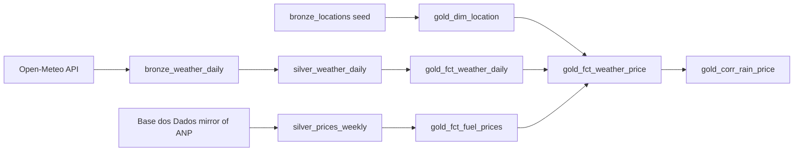

# Agro ELT Project


An ELT pipeline (Python, BigQuery, dbt) that brings together daily weather and weekly fuel prices for five Brazilian agricultural states, and uses them to ask one question:

**does rainfall in sugarcane regions help explain ethanol and gasoline price changes?**

**Short answer: in this data, no detectable relationship** (see [Results](#results)). The pipeline, the tests and the validation of the price source are the main deliverables.

**Live dbt documentation (lineage and column descriptions):** https://carlosmartinez93.github.io/Agro_ELT_Project/

---

## What it does

- Ingests daily weather (temperature, precipitation) for one representative city per state: Ribeirao Preto (SP), Rio Verde (GO), Uberaba (MG), Dourados (MS) and Maringa (PR).
- Reads weekly ANP fuel prices (ethanol and gasoline, by gas station) and aggregates them by week, state and product.
- Joins rainfall to prices at lags of 0 to 8 weeks and computes correlations, raw and seasonally adjusted.
- Runs on GitHub Actions: tests on every pull request, and a daily job that refreshes the data.

## Architecture



| Layer | Objects | Notes |
|---|---|---|
| Bronze | `bronze_weather_daily`, `ingestion_state`, `bronze_locations` (dbt seed) | Weather is loaded by Python with a staging table and a MERGE, so reruns do not duplicate rows. A watermark is kept in `ingestion_state`. |
| Silver | `silver_weather_daily` (view), `silver_prices_weekly` (table) | Weather is deduplicated by (date, location). Prices are aggregated by (week, state, product). |
| Gold | `gold_dim_location`, `gold_dim_date`, `gold_fct_weather_daily`, `gold_fct_fuel_prices`, `gold_fct_weather_price`, `gold_corr_rain_price` | `gold_fct_weather_price` has one row per price week and rainfall lag (0 to 8 weeks). |

## Data sources

| Source | What | Notes |
|---|---|---|
| [Open-Meteo](https://open-meteo.com/) | Daily max/min temperature and precipitation | The archive API is used for the historical backfill (from 2022-01-01) and the forecast API for the daily job. Dates use the America/Sao_Paulo timezone. |
| ANP fuel price survey, through the [Base dos Dados](https://basedosdados.org/dataset/br-anp-precos-combustiveis) mirror | Consumer prices by gas station | Read directly from `basedosdados.br_anp_precos_combustiveis.microdados` as a dbt source. Coverage checked in October 2026: 2022-01-03 to 2026-08-28, about 7 weeks behind. |
| Seed | Five locations with coordinates | `dbt/agro_elt/seeds/bronze_locations.csv` |

**The price source is a third-party mirror.** To check it, `scripts/validate_prices_vs_anp.py` compares `silver_prices_weekly` with the official ANP file for the first half of 2024. All 260 week x state x product cells had the same average price and the same number of observations. Only that semester was checked. A `freshness` check on the source fails the daily job if the mirror stops updating (warn at 75 days, error at 120).

## Results

I tested 90 combinations (5 states x 2 products x 9 lags) between weekly rainfall and the weekly **change** in price. Price levels trend with inflation, and both rainfall and ethanol prices follow the calendar (rainy season, harvest), so correlating levels would mostly measure seasonality. The model therefore reports two versions: raw, and seasonally adjusted (each week minus the mean of the same ISO week across years).

- **After seasonal adjustment, none of the 90 combinations is significant** under a Bonferroni correction for 90 tests (|t| > 3.46).
- Two combinations looked significant in the raw data. Both disappeared after the adjustment. For example, gasoline in SP at lag 5 fell from r = 0.29 to r = 0.19.
- Five of 90 combinations exceeded |t| > 1.96. Chance alone predicts about 4 to 5.

Strongest adjusted correlations (October 2026 run):

| State | Product | Lag (weeks) | r raw | r adjusted | t adjusted |
|---|---|---|---|---|---|
| SP | gasoline | 5 | 0.290 | 0.189 | 2.88 |
| MS | gasoline | 2 | 0.197 | 0.152 | 2.31 |
| GO | ethanol | 7 | 0.150 | 0.150 | 2.26 |
| SP | gasoline | 6 | 0.264 | 0.142 | 2.14 |
| SP | ethanol | 8 | 0.007 | -0.135 | -2.03 |

### What this does not show

"No relationship found" is not "no relationship exists". The test is weak for small effects:

- Rainfall comes from **one city per state**, not from the cane-growing area.
- The weekly retail price is driven mostly by other factors (fuel pricing policy, taxes, harvest).
- With about 225 weeks, only correlations above roughly 0.23 would pass the corrected threshold.
- Only weekly rainfall with linear correlation was tested. Cumulative rainfall or longer lags were not.
- The t-statistics are naive: they ignore autocorrelation, which overstates significance.
- The seasonal adjustment uses only 4 to 5 observations per ISO week.
- Four state-week-product cells (all in MS, 2022-09 to 2023-03) have fewer than 20 stations. A warning test flags them.

## Data quality

33 dbt tests: `not_null`, `unique` (including composite grains), `accepted_values` (states, products, lags), `relationships`, and a warning-level test for thin price weeks. All run on every pull request.

## CI/CD

- **CI (pull requests):** `dbt debug`, `dbt build` and `dbt docs generate` against a separate dataset (`analytics_engineering_ci`), so pull requests never overwrite production tables. The third-party price source is excluded from the docs catalog because the CI service account cannot list its metadata.
- **CD (daily, 10:00 UTC, also manual):** weather ingestion (last 30 days), `dbt build` (seeds, models and tests), then `dbt source freshness` on the price mirror.
- **Docs:** the dbt documentation site is published to GitHub Pages on every push to `main`.
- Authentication to GCP uses Workload Identity Federation (no service account keys). Each dbt query is capped at 10 GB billed (`maximum_bytes_billed`).

## Running locally

Requirements: Python 3.11, a GCP project with billing enabled (BigQuery DML does not work without it) and `gcloud` authenticated (`gcloud auth application-default login`).

```bash
git clone https://github.com/carlosMartinez93/Agro_ELT_Project.git
cd Agro_ELT_Project
python -m venv venv && source venv/bin/activate   # Windows: .\venv\Scripts\Activate.ps1
pip install -q -r requirements.txt

cp .env.example .env   # set GCP_PROJECT_ID and BQ_DATASET
export GCP_PROJECT_ID=your-project BQ_DATASET=analytics_engineering   # dbt reads these from the shell
```

First-time setup, in order:

```bash
# 1. Create the dataset (once) and the bronze tables. The DDL is written for the dataset analytics_engineering.
bq --location=US mk --dataset "$GCP_PROJECT_ID:analytics_engineering"
bq query --project_id="$GCP_PROJECT_ID" --location=US --use_legacy_sql=false < sql/bronze_ddl.sql

# 2. Backfill weather from 2022-01-01 (Open-Meteo archive API)
python ingestion/backfill_weather.py

# 3. Seeds, models and tests
cd dbt/agro_elt && dbt build
```

Daily refresh: `python ingestion/run_weather_ingestions.py`, then `dbt build`.

To check the price source against an official ANP semester file:

```bash
python scripts/validate_prices_vs_anp.py "<path to the ANP CSV>"
```

### GitHub configuration

- Secrets: `WIF_PROVIDER`, `WIF_SERVICE_ACCOUNT`
- Variables: `GCP_PROJECT_ID`, `BQ_DATASET`

## Repository layout

```
.github/workflows/    ci.yml, cd.yml, pages.yml
dbt/agro_elt/         models (silver, gold), seeds, tests, profiles.yml
ingestion/            run_weather_ingestions.py, backfill_weather.py
scripts/              validate_prices_vs_anp.py
sql/                  bronze_ddl.sql
```